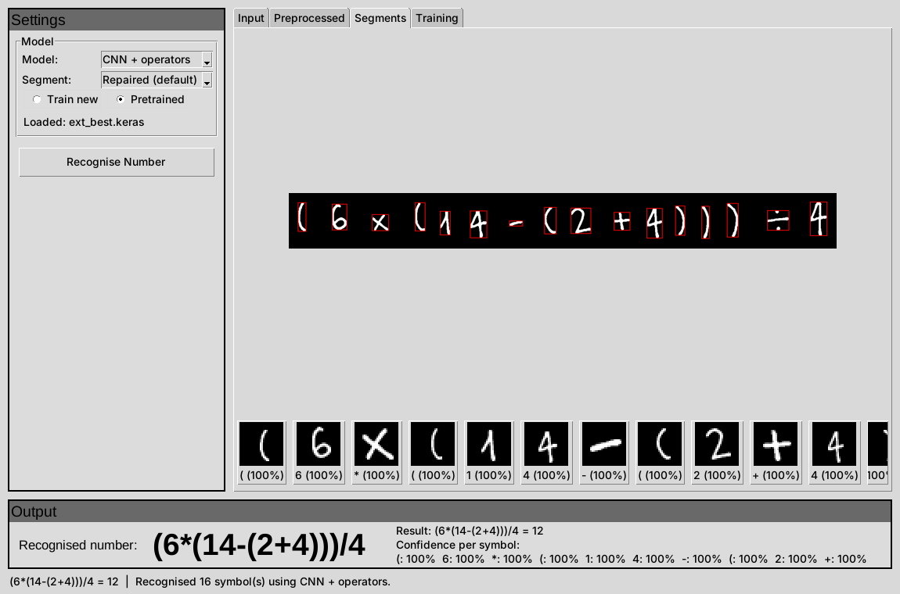

# Handwritten Number Recognition System (HNRS)

COS30018 Intelligent Systems – Option B group project.

The system reads a photo of a handwritten **number** (for example `94026`) and
returns the number. As the research extension, it also reads handwritten
**arithmetic expressions** with `+ − × ÷ ( )` (for example `(6×(14−(2+4)))÷4`).



*The GUI reading an expression written by someone whose handwriting the model
never saw during training. Every symbol is boxed, classified and given a
confidence.*

**Contents**

1. [Quick start: from a fresh clone to a result](#1-quick-start-from-a-fresh-clone-to-a-result)
2. [Using the GUI](#2-using-the-gui)
3. [How the pipeline works](#3-how-the-pipeline-works)
4. [Results at a glance](#4-results-at-a-glance)
5. [Reproducing every result](#5-reproducing-every-result)
6. [Repository map and detailed guides](#6-repository-map-and-detailed-guides)
7. [Data: what is in the repo and what is downloaded](#7-data-what-is-in-the-repo-and-what-is-downloaded)
8. [Project status and known limitations](#8-project-status-and-known-limitations)
9. [Troubleshooting](#9-troubleshooting)
10. [Team and Git workflow](#10-team-and-git-workflow)

---

## 1. Quick start: from a fresh clone to a result

Everything below is run from a terminal. On Windows use PowerShell; the
commands are the same except where a Windows line is shown.

### 1.1 What you need

| Requirement | Notes |
|---|---|
| **Python 3.12** (3.10 and 3.11 also work) | TensorFlow 2.16 does **not** install on Python 3.13. Check with `python --version`. |
| Git | to clone the repository |
| About 3 GB of free disk space | mostly TensorFlow |
| Internet access on first run | `pip install`, and MNIST (11 MB) downloads automatically the first time it is needed |
| Tkinter (for the GUI) | included with Python on Windows and macOS; on Linux run `sudo apt install python3-tk` |

No GPU is needed. Every model in this repository runs on a normal laptop CPU.

### 1.2 Install (once, about 5–10 minutes)

```bash
git clone https://github.com/LinganMcC/COS30018-Assignment.git
cd COS30018-Assignment

python -m venv venv
# Windows (PowerShell)
venv\Scripts\activate
# macOS / Linux
source venv/bin/activate

pip install -r requirements.txt
python src/verify_setup.py
```

`verify_setup.py` must end with **"All required packages present. Environment is ready."**

### 1.3 See it work (1 minute)

The trained models are already in the repository (`models/checkpoints/`), so
nothing needs to be trained before the system can be used.

```bash
# Read a photographed number with the digit model
python models/cnn/inference.py data/custom_samples/numbers/896_t1.jpg
#   cnn_best: '896'   followed by one line per digit with its confidence

# Read a photographed expression with the digits + operators model
python models/cnn/inference.py data/custom_samples/expressions/ready/e090_s3w1.jpg --model ext_best
#   ext_best: '(6*(14-(2+4)))/4'

# Open the graphical interface
python gui.py
```

### 1.4 Check that everything is installed correctly (2 minutes)

```bash
python -m pytest tests -q              # preprocessing and segmentation
python -m pytest evaluation -q         # evaluation metrics, baselines, failure analysis
cd models/cnn
python -m pytest -q                    # models, training, evaluation, GUI backend
cd ../..
```

Both should report only `passed` (and possibly `skipped`, see below), never
`failed`. On a fresh clone about 24 tests in `tests/` are **skipped** because
they need generated data. To create that data and run them too:

```bash
python src/prepare_data.py             # MNIST digits as PNG files in data/raw/        (~5 s)
python src/generate_number.py --count 30   # multi-digit number images in data/generated/  (~1 s)
python src/digit_classifier.py         # small classifiers used by some segmenters      (~5 s)
python -m pytest tests -q              # now nothing is skipped
```

---

## 2. Using the GUI

```bash
python gui.py          # from the repository root
```

1. **Choose a model** in *Settings → Model*:

   | Option | What it reads | Model file |
   |---|---|---|
   | **CNN** | numbers (digits 0–9) | `models/checkpoints/cnn_best.keras` |
   | **CNN + operators** | numbers and expressions with `+ − × ÷ ( )` | `models/checkpoints/ext_best.keras` |
   | MLP | numbers – a simple neural network, for comparison | `models/checkpoints/mlp_best.keras` |
   | SVM | numbers – HOG features + SVM, classical baseline | `models/checkpoints/hog_svm.joblib` |
   | Random Forest | numbers – HOG features + Random Forest, classical baseline | `models/checkpoints/hog_rf.joblib` |

   *CNN* is the system's model. The other three are the Task 3 comparison
   models: reading the same photo with each shows the differences measured in
   [section 4](#4-results-at-a-glance).

2. **Choose where the model comes from:**
   - **Pretrained** loads the frozen model in the table above (a few seconds the first time).
   - **Train new** trains a fresh model on MNIST (or MNIST + operator symbols
     for *CNN + operators*) with your own settings: architecture
     (`lenet`, `vgg_deep`, `resnet`), augmentation (`none` … `strong`),
     learning rate, batch size and epochs. Training runs in the background;
     the *Training* tab shows the loss and accuracy curves live, and **Stop**
     ends it after the current batch. Trained models are saved in
     `models/gui_runs/` (not committed). Training *CNN + operators* needs the
     operator symbol images (section 7); training *CNN* only needs MNIST.
     *MLP* uses the same settings with the MLP architecture. *SVM* and
     *Random Forest* have no epochs or learning rate: they are fitted once on
     10,000 MNIST images with the settings tuned in `evaluation/baselines.py`
     (SVM about 3 minutes, Random Forest under 1; Stop works only before the
     fit starts).

3. **Load an image:** *Input → Load image…* or drag a file onto the window.
   Try any file in `data/custom_samples/numbers/` or
   `data/custom_samples/expressions/ready/`.

4. Press **Recognise Number**. The result appears under *Output* with a
   confidence for every symbol. The *Preprocessed* tab shows the binary image,
   and the *Segments* tab shows each box and the exact 28×28 image the model saw.

Every model option uses the project's own preprocessing and segmentation
(section 3), so all five see exactly the same 28×28 inputs – the GUI reads the
real test photos exactly as `evaluation/evaluate_all.py` scored them. The
*Preprocessing* and *Segmentation* panels on the left are not used.

---

## 3. How the pipeline works

```
 image file ──► 1. Segmentation ──► 2. Preprocessing ──► 3. Recognition ──► 4. Output
 (photo, or a      split into one       each crop becomes      a CNN classifies     join the symbols:
  generated        box per symbol,      a 28×28 image in        each 28×28 image     "896" or
  number)          left to right        MNIST format                                 "(3+4)*5"
                   src/segmentation.py  src/preprocessing.py    models/checkpoints/  models/cnn/inference.py
```

The figure below is produced by `python experiments/demo_one.py` and shows
every stage on one real photo:


**1. Segmentation** – `segment_digits()` / `segment_expression()` in `src/segmentation.py` (Task 2)

- The photo is converted to grey, median-filtered and binarised with Otsu's
  threshold, so ink becomes white and paper black.
- The outer contour of every ink region gives a bounding box (`contours`
  method). Boxes too small to be a digit are dropped as noise.
- For expressions (`segment_expression`), short and flat shapes are kept as
  operators, and the bar and dots of a `÷` are merged into one box.
- Boxes are sorted left to right. Each box is then cut from the **original
  photo**, not from the binary image, because preprocessing expects ink on paper.
- Four classical methods and six model-based ones were compared;
  `contours` was selected because it was best on real photos (section 4).

**2. Preprocessing** – `preprocess()` in `src/preprocessing.py` (Task 1)

The selected configuration, `otsu_mnist_box`, turns each crop into exactly the
format the models were trained on:

1. convert to greyscale;
2. Otsu threshold, so strokes are white on a black background as in MNIST;
3. crop to the ink, scale the longer side to 20 pixels **keeping the aspect
   ratio**, and place it in a 28×28 frame centred on its centre of mass. This is
   how MNIST itself was built; without it a thin `1` is stretched into a block;
4. scale pixel values to 0–1.

Eight configurations were compared (section 4).

**3. Recognition** – `models/cnn/` (Task 3)

- **Numbers:** `cnn_best`, a 3-block VGG-style CNN (0.59 M parameters), tuned
  for learning rate, dropout, batch size and augmentation. It was compared with
  two classical models (HOG features + SVM, HOG + Random Forest), an MLP,
  LeNet-5 and a small ResNet (section 4).
- **Expressions:** `ext_best`, the same architecture with 16 outputs
  (`0–9 + − × ÷ ( )`). It was trained on MNIST + operator symbols (HASYv2 and
  Kaggle), then fine-tuned on symbols cut from the team's own handwriting with
  blur / sharpen / stroke-width augmentation.
- Every frozen model has a `.labels.json` (class names) and a `.source.json`
  (which training run it came from) next to it.

**4. Output** – `Recogniser.read_image()` in `models/cnn/inference.py`

`read_image()` runs stages 1–3 and returns the text plus, for every symbol, its
label, confidence, top-3 alternatives, box and 28×28 input. This one function
is what the GUI and the evaluation scripts call.

```python
import sys, cv2
sys.path.insert(0, "models/cnn")          # run from the repository root
from inference import Recogniser

image = cv2.imread("data/custom_samples/numbers/896_t1.jpg")
text, details = Recogniser("cnn_best").read_image(image)    # '896'
text, details = Recogniser("ext_best").read_image(image)    # also reads + − × ÷ ( )
```

**Input from a folder of digit images.** The specification also asks for a
number image built automatically from single-digit images:
`python src/generate_number.py` builds them from MNIST digits with ground-truth
labels (`--expressions` builds arithmetic expressions instead). Wiring this
into the GUI is still open (section 8).

---

## 4. Results at a glance

All numbers are produced by scripts in this repository (section 5). "Real"
means photos of the team's own handwriting in `data/custom_samples/`, which no
model was trained on unless stated.

**Task 1 – preprocessing** (8 configurations; `src/preprocessing.py`)

| Configuration | MNIST (LeNet, 5 seeds) | 149 real digits | 99 real numbers, end to end |
|---|---|---|---|
| **otsu_mnist_box (selected)** | 96.0 % | **81.9 %** | **62 %** |
| otsu_denoised_centered | 95.6 % | 79.9 % | 7 % |
| otsu | 96.7 % | 76.5 % | 1 % |
| grayscale_only | 96.7 % | 61.1 % | 1 % |

On MNIST all configurations are within noise of each other; only real photos
can tell them apart. Full table: `reports/report_task1_preprocessing.md`.

**Task 2 – segmentation** (correct number of boxes; `src/segmentation.py`)

| Method | 30 generated numbers | 99 real numbers | Real, read exactly |
|---|---|---|---|
| **contours (selected)** | 70 % | **75 %** | **62 %** |
| connected_components | 70 % | 75 % | 62 % |
| watershed | 50 % | 52 % | 34 % |
| projection | 83 % | 17 % | 5 % |

Projection wins on generated numbers but fails on real handwriting. Digits that
touch are the main limitation. Full analysis: `reports/report_task2_segmentation.md`.

**Task 3 – recognition techniques** (three families, each model at its best tuned settings)

| Model | Family | MNIST test | MNIST shifted | Real single digits (149) | Real numbers, whole number (99) |
|---|---|---|---|---|---|
| HOG + SVM (RBF) | classical ML | 98.9 % | 78.0 % | 79.9 % | 53.5 % |
| HOG + Random Forest | classical ML | 97.7 % | 77.2 % | 73.2 % | 48.5 % |
| MLP (no convolutions) | simple neural | 99.0 % | 96.9 % | 57.0 % | 27.3 % |
| LeNet-5 | CNN | 99.3 % | 98.1 % | 83.9 % | 60.6 % |
| ResNet (small) | CNN | 99.6 % | 99.5 % | 83.9 % | 55.6 % |
| **VGG-deep = `cnn_best`** | CNN | **99.6 %** | 99.5 % | **86.6 %** | **63.6 %** |

On MNIST alone the models are within one point of each other; shifted and real
input separate them. VGG-deep is significantly better (McNemar's test) than the
classical models and the MLP on every test set, and never significantly worse
than the other CNNs. Full comparison, significance tests and the justified
selection: `evaluation/report_comparison_of_techniques.md`.

**Task 4 – the whole system** (VGG-deep; per-digit and whole-number accuracy kept separate)

| Test set | Digit count right | Per-digit accuracy | Whole-number accuracy |
|---|---|---|---|
| 600 generated numbers (MNIST test digits; wide / tight / touching) | 68.7 % | 81.8 % | 60.0 % |
| 99 real photographed numbers | 74.7 % | 72.7 % | 63.6 % |
| … of which digits apart / touching | 95.9 % / 12.0 % | – | 82.4 % / 8.0 % |

About 70 % of failures happen in segmentation (mostly touching digits cut as
one), not recognition: when a number is cut correctly, 90.5 % of real digits are
read right. Critical analysis: `evaluation/report_system_performance.md`.

**Extension – handwritten expressions** (408 expressions by 14 writers whose
handwriting was **not** used for training)

| | Before fine-tuning | **After (`ext_best`)** |
|---|---|---|
| Expression read exactly | 70.8 % | **87.5 %** |
| Symbols read correctly | 94.2 % | **97.4 %** |
| Expressions with brackets / nested brackets | 64.9 % / 63.5 % | 87.4 % / 75.0 % |
| MNIST + symbols test set | 99.57 % | 99.38 % |

89 % of expressions are cut into the right number of symbols, so segmentation
is now the limit. Details and ablations: `models/experiments/eval/retraining_report.md`.

---

## 5. Reproducing every result

Run from the repository root unless the command starts with `cd`. Times are
for a laptop CPU.

| Result | Command | Time | Output |
|---|---|---|---|
| One image, every step shown | `python experiments/demo_one.py data/custom_samples/numbers/896_t1.jpg` | 10 s | terminal + `reports/demo_one.png` |
| Task 1 + 2 summary of every technique (no TensorFlow) | `python experiments/show_techniques.py` | 5 s | terminal + `reports/*_visual.png` |
| Task 1 + 2 on real photos | `python experiments/evaluate_custom.py` | 3–4 min | `reports/custom_*.csv` |
| Task 2 on generated numbers (run the data steps in 1.4 first) | `python experiments/demo_segmentation.py` | 10 s | `reports/segmentation_comparison.csv` |
| Task 3 classical baselines (train once) | `python evaluation/baselines.py` | 30–40 min | `models/checkpoints/hog_*.joblib`, `evaluation/results/baseline_tuning.csv` |
| Task 3 + 4 all six models on every test set | `python evaluation/generated_set.py` (once) → `python evaluation/evaluate_all.py` | 5–10 min | `evaluation/results/model_comparison.md`, charts |
| Task 4 failure analysis | `python evaluation/error_analysis.py` | 1 min | `evaluation/results/failure_analysis.md`, `failure_gallery.png` |
| Task 3 training curves of the neural models | `cd models/cnn` → `python compare_models.py --set best` | 5 s | `models/experiments/compare_best_*.png`, `compare_best_table.md` |
| Task 3 per-class precision / recall / F1 | `cd models/cnn` → `python evaluate_classes.py` | 1–2 min | `models/experiments/eval/*_report.md`, `*_confusion.png` |
| Task 4 every model on real photos | `cd models/cnn` → `python evaluate_real.py` | 2 min | `models/experiments/eval/real_handwriting.md` |
| Extension on real expressions | `cd models/cnn` → `python evaluate_expressions.py` | 2 min | `models/experiments/eval/expressions_report.md` |
| Extension before fine-tuning | `cd models/cnn` → `python evaluate_expressions.py --model ext_v2 --tag _ext_v2_test` | 2 min | `expressions_report_ext_v2_test.md` |

`evaluate_classes.py` needs the operator symbol images (section 7) for the
16-class model; run it with `--model cnn_best` if you have not downloaded them.

Retraining any model is described in the lane guides (section 6). It is never
needed to use or evaluate the system.

---

## 6. Repository map and detailed guides

```
COS30018-Assignment/
├── gui.py                      the graphical interface (start here)
├── requirements.txt            exact package versions
├── src/                        Task 1 preprocessing, Task 2 segmentation, data tools   → src/README.md
├── experiments/                Task 1 + 2 comparison scripts                           → src/README.md
├── reports/                    Task 1 + 2 results (CSV, figures) and report sections
├── models/
│   ├── cnn/                    Task 3 models, training, evaluation, GUI backend        → models/cnn/README.md
│   ├── checkpoints/            the trained models used by the system (committed)
│   └── experiments/            training logs, tuning tables, evaluation results
├── evaluation/                 Task 3 baselines, Task 4 evaluation, failure analysis   → evaluation/README.md
├── data/custom_samples/        the team's real handwriting (test photos, committed)
│   ├── digits/  numbers/       149 single digits, 99 numbers (label = file name)
│   └── expressions/ready/      823 photos of 120 expressions (4 sheets x 7 writers) + labels.csv
├── tests/                      unit tests for src/
└── docs/images/                figures used in this README
```

**Detailed guides – one per part of the system.** Each lists every script, what
it does, its options and where its output goes.

| Part | Owner | Guide |
|---|---|---|
| Preprocessing, segmentation, test data, number generator (Tasks 1–2) | John | [`src/README.md`](src/README.md) |
| Recognition models, training, tuning, extension model, evaluation scripts, GUI backend (Task 3, extension model) | Thien | [`models/cnn/README.md`](models/cnn/README.md) |
| Classical baselines, model comparison, system evaluation, failure analysis (Tasks 3–4) | Liam (written by Thien) | [`evaluation/README.md`](evaluation/README.md) |
| GUI, expression parser, packaging (GUI, extension) | Russell | *to be added*; GUI use is in section 2 |

---

## 7. Data: what is in the repo and what is downloaded

| Data | In the repo? | How to get it | Needed for |
|---|---|---|---|
| Trained models (`models/checkpoints/*.keras`, `*.joblib`) | **yes** | – | using and evaluating the system |
| Generated test numbers (`data/generated_test/`) | no | `python evaluation/generated_set.py` (rebuilt identically from a seed) | `evaluate_all.py`, `error_analysis.py` |
| Team's real handwriting (`data/custom_samples/`) | **yes** | – | all real-world results |
| MNIST | no | downloads automatically on first use (11 MB, to `~/.keras/datasets/`) | training, `evaluate_classes.py`, `prepare_data.py` |
| MNIST digits as PNG files (`data/raw/`) | no | `python src/prepare_data.py` | number generator, some tests |
| Generated numbers / expressions (`data/generated*/`) | no | `python src/generate_number.py [--expressions]` | Task 2 comparisons on generated images |
| Operator symbols (`data/symbols/`) | no | `python src/download_symbols.py` – see the note below | training or evaluating the 16-class model on symbols |

**Operator symbols.** HASYv2 downloads automatically. The Kaggle part
(*Handwritten math symbols*, `xainano/handwrittenmathsymbols`) needs a manual
download because Kaggle requires a login: download `data.rar`, extract it into
`data/downloads/xainano/`, then run `python src/download_symbols.py --clean`.
`python src/download_symbols.py --check` reports what is present.

**Adding your own handwriting.** Put the label first in the file name:
`data/custom_samples/digits/3_01.jpg` (the digit 3) or
`data/custom_samples/numbers/2026_01.jpg` (the number 2026). A sheet with
many numbers can be cut automatically with `src/split_sheet.py`.

---

## 8. Project status and known limitations

| Part | Status |
|---|---|
| Task 1 – preprocessing (8 techniques compared, one selected) | done |
| Task 2 – segmentation (10 techniques compared, one selected; operators supported) | done |
| Task 3 – four neural models compared, tuned and frozen | done |
| Task 3 – classical baselines (HOG + SVM, HOG + Random Forest), six-model comparison with significance tests | done |
| Task 4 – per-digit and whole-number evaluation on generated and real input, critical analysis | done |
| GUI – load image, choose model, pretrained or train new, live curves, per-symbol confidence | done |
| GUI – build a number from a folder of digit images | **open** – Russell (`src/generate_number.py` exists) |
| GUI – MLP / SVM / Random Forest options, pretrained or train new | done |
| Extension – recognise handwritten expressions | done (87.5 % exact on unseen writers) |
| Extension – calculate the result with a parser (operator precedence, brackets, no `eval()`) | **open** – Russell |

**Known limitations (measured, with the evidence in the files named):**

- **Touching digits.** When two digits touch, segmentation returns one box for
  both; this causes most whole-number errors (`reports/report_task2_segmentation.md`).
- **Real handwriting is harder than MNIST.** Every model scores about 99 % on
  MNIST and 57–87 % on real single digits (`models/experiments/eval/real_handwriting.md`).
- **Ruled paper.** Lines are kept as ink; single-digit accuracy on the lined
  sheet is 30 % against 90 % on plain paper (`src/preprocessing.py`).
- **Nested brackets.** Only 78 % of nested-bracket expressions are cut into
  the right number of symbols (`models/experiments/eval/expressions_report.md`).

---

## 9. Troubleshooting

| Problem | Fix |
|---|---|
| `No matching distribution found for tensorflow==2.16.1` | You are on Python 3.13. Install Python 3.12 and recreate the virtual environment. |
| Windows: TensorFlow install fails with a long-path error | Enable long paths (`Settings → System → For developers → Enable long paths`) or clone into a short folder such as `C:\hnrs`. |
| `ModuleNotFoundError: No module named 'inference'` (or `trainer`, `datasets`) | Scripts in `models/cnn/` are run from inside that folder: `cd models/cnn` first. |
| `ModuleNotFoundError: No module named 'tkinter'` (Linux) | `sudo apt install python3-tk` |
| Drag and drop does not work in the GUI | `tkinterdnd2` is missing; `pip install tkinterdnd2`. *Load image…* always works. |
| MNIST download fails (no internet, proxy) | Copy `mnist.npz` into `~/.keras/datasets/` (Windows: `C:\Users\<you>\.keras\datasets\`). |
| `labels.csv not found` from `evaluate_expressions.py` | The expression photos must be in `data/custom_samples/expressions/ready/`. |
| GUI *Pretrained* loads an unexpected model | A file in `pretrained_models/` whose name starts with the model name takes priority over `models/checkpoints/`. Remove it. |
| Many `oneDNN` / `cpu_feature_guard` lines when TensorFlow starts | Harmless information messages. Hide them with `set TF_CPP_MIN_LOG_LEVEL=2` (Windows) or `export TF_CPP_MIN_LOG_LEVEL=2`. |

---

## 10. Team and Git workflow

| Member | Role | Owns |
|---|---|---|
| John | Data and vision | Task 1 preprocessing, Task 2 segmentation, real test data |
| Thien | Deep models | Task 3 CNNs, augmentation, tuning, extension model |
| Liam | Baselines and evaluation | Task 3 baselines, Task 4 evaluation |
| Russell | Systems and extension | GUI, pipeline integration, expression parser, packaging |

Never commit directly to `main`:

```bash
git switch main
git pull
git switch -c feature/<name>-<what>         # e.g. feature/liam-eval-harness
# ...work, then:
git status                                  # check nothing unexpected is listed
git add <files>
git commit -m "what you did"
git push -u origin feature/<name>-<what>
```

Then open a pull request on GitHub and ask a teammate to review it.

- Do not commit datasets, `venv/`, `models/gui_runs/` or per-run tuning models;
  `.gitignore` covers them.
- The CSVs and figures in `reports/` and `models/experiments/` **are**
  committed on purpose: they are the evidence for every comparison above.
