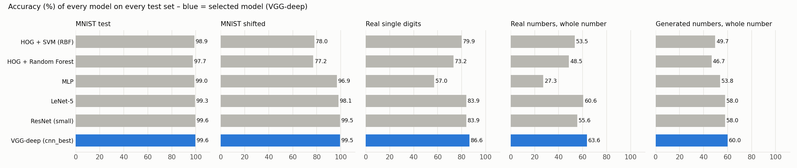

# Comparison of ML techniques (Task 3)

*Report section. Every number comes from `evaluation/results/model_comparison.md`,
produced by `python evaluation/evaluate_all.py`; the neural models' training is
described in `models/cnn/README.md`.*

## 1. Techniques compared

Six classifiers from three families were trained for the same job: label a
28×28 image of one handwritten digit as 0–9.

| Family | Model | How it works | Size |
|---|---|---|---|
| Classical ML | **HOG + SVM** | Histogram-of-oriented-gradients features (edge directions in 4×4-pixel cells, 1,296 values) classified by a support vector machine with an RBF kernel | 14,398 support vectors |
| Classical ML | **HOG + Random Forest** | The same features, classified by 200 decision trees voting | 1.56 M tree nodes |
| Simple neural network | **MLP** | Fully connected layers on the 784 raw pixels; no notion of neighbouring pixels | 1.34 M parameters |
| Convolutional network | **LeNet-5** | Two convolution + pooling stages, then dense layers – the classic digit CNN | 0.06 M parameters |
| Convolutional network | **ResNet (small)** | Convolution blocks with skip connections | 0.17 M parameters |
| Convolutional network | **VGG-deep** | Three blocks of stacked 3×3 convolutions with batch normalisation and dropout | 0.59 M parameters |

The classical models are the non-neural reference point; the MLP sits between
them and the CNNs. HOG was chosen as the classical feature because it describes
a digit by the direction of its strokes, which is how a digit is recognised by
shape; it is the standard non-neural feature for handwritten digits.

## 2. How each was trained and tuned

All six use the same fixed MNIST split – 54,000 training, 6,000 validation,
10,000 test images (`models/cnn/mnist_loader.py`). Every choice was made on
**validation** accuracy; each test set was scored only after the model was fixed.

- **HOG + SVM / Random Forest** (`evaluation/baselines.py`). The HOG cell size
  (7×7 or 4×4 pixels) and then the classifier settings were grid-searched on
  12,000 training images: SVM C ∈ {1, 5, 10, 20} × γ ∈ {scale/2, scale, scale×2};
  forest max_features ∈ {√n, 0.2} × min_samples_leaf ∈ {1, 2}. The finer 4×4 cells
  won for both (SVM validation 98.3 % vs 97.5 %; forest 96.8 % vs 95.4 %). The chosen
  settings – SVM C = 5, γ = 2 × scale; forest √n features, leaf size 1 – were then
  trained on all 54,000 images. All 18 settings tried: `evaluation/results/baseline_tuning.csv`.
- **Neural models** (`models/cnn/trainer.py`). Adam optimiser, early stopping on
  validation accuracy, light augmentation (±8° rotation, ±8 % shift and zoom).
  VGG-deep was tuned in two stages (augmentation, then learning rate / dropout /
  batch size, one at a time); LeNet, ResNet and the MLP were each tuned for
  dropout and augmentation so that every model is compared at its best
  (`models/experiments/tuning_table.md`, `compare_best_table.md`).

## 3. Results

| Model | MNIST test | MNIST shifted | Real digits (149) | Real numbers, whole number (99) | Generated numbers, whole number (600) |
|---|---|---|---|---|---|
| HOG + SVM | 98.9 % | 78.0 % | 79.9 % | 53.5 % | 49.7 % |
| HOG + Random Forest | 97.7 % | 77.2 % | 73.2 % | 48.5 % | 46.7 % |
| MLP | 99.0 % | 96.9 % | 57.0 % | 27.3 % | 53.8 % |
| LeNet-5 | 99.3 % | 98.1 % | 83.9 % | 60.6 % | 58.0 % |
| ResNet (small) | 99.6 % | 99.5 % | 83.9 % | 55.6 % | 58.0 % |
| **VGG-deep** | **99.6 %** | 99.5 % | **86.6 %** | **63.6 %** | **60.0 %** |

*MNIST shifted* is the same 10,000 test images, each slightly rotated, shifted and
zoomed. *Real* is photos of the team's own handwriting; *generated* is numbers
composed from MNIST test digits. On real and generated numbers every model reads
the same crops from the same segmentation, so the differences are recognition only.

**Recognition alone.** Counting only the numbers that segmentation cut into the
right number of pieces, VGG-deep reads 90.5 % of real digits and 96.0 % of
generated digits correctly; the HOG SVM 84.1 % and 90.9 %; the MLP 55.9 % and 93.1 %.

Per-digit precision, recall and F1 for every model: `results/mnist_per_class.csv`.
VGG-deep's F1 on MNIST test is between 99.5 % and 99.9 % for every digit; its most
frequent confusions are 9 → 4 (5 images) and 5 → 3 (4) (`results/confusion_mnist.png`).

## 4. What the comparison shows

**MNIST alone cannot separate the models.** Five of the six score between 98.9 %
and 99.6 % on the standard test set. A difference of 0.7 points there would not
justify a choice; the other test sets were needed.

**The families fail in different ways, and for explainable reasons.**

- **HOG features are tied to fixed positions.** A HOG cell describes the edges in
  one fixed 4×4 patch of the image, so a digit shifted by a few pixels produces
  different features. Both classical models fall from 98–99 % to 77–78 % on the
  shifted test set, while the CNNs, whose convolution and pooling layers are
  built to tolerate small shifts, lose at most 1.2 points.
- **The MLP has no notion of shape.** It treats the 784 pixels as unrelated
  numbers. It copes with shifted MNIST (96.9 %, helped by augmentation) but reads
  only 57.0 % of real photographed digits – worse than the HOG SVM (79.9 %) –
  because real strokes differ in thickness and style from MNIST and the MLP has
  learned MNIST's pixels rather than the strokes. On real numbers it reaches
  27.3 %.
- **The CNNs are best on every test set.** Convolutions learn local stroke
  patterns that transfer from MNIST to real handwriting.

**Is VGG-deep really better? McNemar's exact test** compares two models on the
same images, counting only images that one gets right and the other wrong
(`results/significance.csv`):

| VGG-deep against | MNIST test | Real digits | Real numbers | Generated numbers |
|---|---|---|---|---|
| HOG + SVM | better (p < 0.001) | better (p = 0.021) | better (p = 0.006) | better (p < 0.001) |
| HOG + Random Forest | better (p < 0.001) | better (p < 0.001) | better (p < 0.001) | better (p < 0.001) |
| MLP | better (p < 0.001) | better (p < 0.001) | better (p < 0.001) | better (p < 0.001) |
| LeNet-5 | better (p < 0.001) | no significant difference (p = 0.39) | no significant difference (p = 0.38) | borderline (p = 0.05) |
| ResNet (small) | no significant difference (p = 0.51) | no significant difference (p = 0.29) | better (p = 0.008) | better (p = 0.023) |

VGG-deep is significantly better than both classical models and the MLP on every
test set. Against the other two CNNs the picture is closer: it is significantly
better than LeNet-5 on MNIST and than ResNet on real and generated numbers, and
never significantly worse than either.

## 5. Model selected for the system: VGG-deep (`cnn_best`)

1. **Highest score on four of the five test sets**, and within 0.1 point of the best on
   the fifth (shifted MNIST: ResNet 99.54 %, VGG-deep 99.47 %).
2. **Significantly better than every non-CNN technique** on all four test sets
   where a test was run, and significantly better than each other CNN on at least
   one real-world test set, never significantly worse.
3. **Most robust to the variation real input brings:** the highest real-digit
   (86.6 %) and real-number (63.6 %) accuracy, and 99.5 % on shifted MNIST.
4. **Practical:** 0.59 M parameters, about 13 minutes to train on a laptop CPU,
   and fast enough to read a number in the GUI without a visible delay. ResNet is
   comparable on MNIST but took 32 minutes to train and is worse on real numbers.

The same architecture was used for the extension's 16-class model (`ext_best`),
which adds `+ − × ÷ ( )` (see `models/experiments/eval/retraining_report.md`).

## 6. Limitations of this comparison

- The real test sets are small (149 digits, 99 numbers from four writers): the
  95 % confidence interval on VGG-deep's real-digit accuracy is 80–91 %, and it
  overlaps LeNet's and ResNet's. Those three are reported as close, not ranked.
- The classical models were tuned over 18 settings in total and the neural models
  over a similar number of runs; a wider search could narrow some gaps, but not
  the shift-robustness gap, which comes from how HOG features are built.
- All models were trained on MNIST only (the extension model aside); every model
  would gain from training on the team's own handwriting, as the extension's
  retraining showed (70.8 % → 87.5 % exact expressions).
