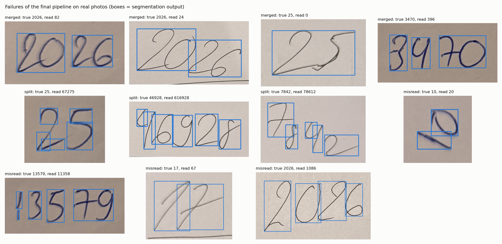

# Overall system functions and performance (Task 4)

*Report section. Numbers come from `evaluation/results/model_comparison.md` and
`failure_analysis.md` (`python evaluation/evaluate_all.py`,
`python evaluation/error_analysis.py`) and, for the extension, from
`models/experiments/eval/expressions_report.md`.*

## 1. What the system does

| Function | How | Where |
|---|---|---|
| Read a handwritten number from a photo | segmentation → preprocessing → CNN, digits joined left to right | `models/cnn/inference.py` (`Recogniser`) |
| Build a test number automatically from single-digit images | digit images from a folder placed side by side, with the true label recorded | `src/generate_number.py` |
| Show every step | the binary image, every segmented box, the 28×28 input of each digit, and a confidence for each digit | GUI tabs *Preprocessed*, *Segments*; *Output* panel |
| Choose the model and its source | *CNN* or *CNN + operators*; frozen pretrained model, or train a new one with chosen architecture, augmentation, learning rate, batch size and epochs, with live curves and *Stop* | GUI *Settings* |
| Read handwritten arithmetic (extension) | the same pipeline with operator-aware segmentation and a 16-class CNN | GUI *CNN + operators*; `evaluate_expressions.py` |

Pipeline of the final system: **contours** segmentation (`src/segmentation.py`) →
**otsu_mnist_box** preprocessing (`src/preprocessing.py`) → **VGG-deep** (`cnn_best`)
for numbers, or `ext_best` for expressions.

## 2. How it was evaluated

| Test set | Size | What it tests |
|---|---|---|
| MNIST test | 10,000 single digits | recognition under the training distribution |
| Real single digits | 149 photos, 4 writers | recognition of real handwriting |
| Real numbers | 99 photos of 2–5 digits, 4 writers, 6 sheets; 25 with touching digits | the whole pipeline on real input |
| Generated numbers | 600 numbers of 2–5 MNIST **test** digits; 200 each at wide (14 px), tight (−6 px) and touching (−14 px) spacing | the whole pipeline under controlled spacing, with digits no model was trained on |
| Expressions (extension) | 408 photos by 14 writers never used in training | the extension end to end |

As the specification requires, two measures are reported for numbers and kept separate:

- **Per-digit accuracy** – 1 − edit distance ÷ number of true digits, so a wrong,
  missing or extra digit each counts as one error. Also given only on numbers cut
  into the right number of pieces, which isolates recognition.
- **Whole-number accuracy** – a number counts only if every digit is right.

## 3. Results

**Single digits**

| Test set | Accuracy (95 % CI) |
|---|---|
| MNIST test | 99.62 % |
| MNIST test, shifted | 99.47 % |
| Real photographed digits | 86.6 % (80–91) |

**Numbers – the two Task 4 measures**

| Test set | Digit count right (segmentation) | Per-digit accuracy | Per-digit, when the count is right | Whole-number accuracy |
|---|---|---|---|---|
| Generated, wide spacing | 86.0 % | – | – | 73.5 % |
| Generated, tight spacing | 88.5 % | – | – | 77.0 % |
| Generated, touching | 31.5 % | – | – | 29.5 % |
| **Generated, all 600** | 68.7 % | **81.8 %** | 96.0 % | **60.0 %** |
| Real, digits apart (74) | 95.9 % | – | – | 82.4 % |
| Real, digits touching (25) | 12.0 % | – | – | 8.0 % |
| **Real, all 99** | 74.7 % | **72.7 %** | 90.5 % | **63.6 %** (54–72) |

**Extension – handwritten expressions** (408, writers not used in training)

| Measure | Result |
|---|---|
| Symbol recognition accuracy (1 − edit distance ÷ length) | **97.4 %** |
| Expression read exactly | 87.5 % |
| Calculated result correct | **87.5 %** |
| Right number of symbols found | 89.0 % |
| By difficulty: one operator / two operators / brackets / nested brackets | 95.4 % / 91.4 % / 87.4 % / 75.0 % |

The calculated result was computed by a small precedence- and bracket-aware
evaluator in `evaluate_expressions.py` (no `eval()`); it will be replaced by the
system's own parser when that is integrated.

## 4. Critical analysis: where and why it fails

Every failed number was put in one category by comparing the segmentation boxes
with the true digits (`evaluation/error_analysis.py`):

| Category | Rule | Real (36 failures) | Generated (240 failures) |
|---|---|---|---|
| merged | fewer boxes than digits, no digit-sized ink discarded | 22 (61 %) | 115 (48 %) |
| dropped | fewer boxes, and the discarded ink adds up to a digit | 0 | 73 (30 %) |
| split | more boxes than digits | 3 (8 %) | 0 |
| misread | right number of boxes, a digit wrong | 11 (31 %) | 52 (22 %) |
| **segmentation total** | | **69 %** | **78 %** |

**1. Segmentation, not recognition, limits the system.** About seven in ten
failures happen before the CNN sees the image. When segmentation is right the
CNN reads 90.5 % of real digits and 96.0 % of generated ones, and 85.1 % of
correctly cut real numbers end to end. The CNN comparison (Task 3) moves
whole-number accuracy by a few points; segmentation decides tens of points.

**2. Touching digits are the dominant failure.** The `contours` method finds one
box per connected region of ink, so digits whose strokes touch become one box.
Real numbers with touching digits are read correctly 8 % of the time, against
82.4 % when the digits are apart; generated touching numbers 29.5 % against
73.5–77.0 %. All 22 real "merged" failures are touching numbers. This was a known
limitation when `contours` was selected (Task 2): the model-based alternatives
tried did not beat it on real photos.

**3. Faint digits are dropped – on generated input only.** At wide spacing,
where digits cannot touch, 28 of 53 failures are a digit vanishing entirely. The
thin, faint MNIST strokes break into several fragments after thresholding, and
each fragment is smaller than the noise filter's minimum size, so all are
discarded (example: "28379" read as "2879"). No real photo failed this way –
pen strokes stay continuous – so this mainly affects the generated input mode.

**4. Recognition errors come from writing style.** The 11 real misreads include
5 → 3, 9 → 8 and 1 → 6 (two each); on generated numbers 4 → 1 (8), 9 → 4, 3 → 5 and
7 → 1 (5 each). These are shapes where the writer's style overlaps another digit's
MNIST shape. The extension showed the remedy: fine-tuning on the team's own
handwriting raised "1" from 68 % to 99 % and "7" from 86 % to 100 % on unseen
writers (`models/experiments/eval/retraining_report.md`).

**5. Writing conditions matter more than the writer.** Whole-number accuracy by
sheet ranges from 83.3 % to 33.3 %; the 33.3 % sheet is the one written on
hand-ruled lines with slanted writing. Otsu thresholding keeps the ruled line
as ink, which joins digits and adds bars to them (on the same sheet single digits
fall to 30 %, against 90 % on plain paper – Task 1 analysis).

**6. The gap between MNIST and real handwriting is large.** The same model reads
99.6 % of MNIST digits and 86.6 % of photographed ones. MNIST accuracy alone would
have overstated the system badly; every selection in this project was therefore
checked on real photos.

**7. The model knows when it is unsure.** On real numbers cut correctly, digits
read right have a median confidence of 1.00; digits read wrong, 0.82. Flagging
digits below 0.9 confidence would mark 26 of 220 digits and catch 62 % of the
wrong ones (`results/confidence.png`) – a cheap way for the GUI to tell the user
which digit to check.

**8. The extension inherits the same limit.** Of the 51 failed expressions, 45 are
a wrong number of symbols (segmentation) and only 6 a misread symbol. Nested
brackets are hardest: 21.9 % of them are cut wrongly, because a bracket written
close to a digit touches it.

## 5. What would improve the system most

In order of expected gain, from the evidence above:

1. **Split boxes that hold more than one digit** (touching digits) – e.g. split
   boxes much wider than a typical digit at the column of least ink, or with the
   model-confidence splitter already in `src/segmentation_ml.py`. Targets 61 % of
   real failures.
2. **Group stroke fragments before the noise filter** so faint digits are not
   discarded – targets 30 % of generated-number failures.
3. **Remove ruled lines** before segmentation (long, thin horizontal components).
4. **Fine-tune the digit model on the team's handwriting**, as was done for the
   extension.
5. **Show low-confidence digits in the GUI** so the user can correct them.

## 6. Limitations of this evaluation

- The real test sets are small: 149 digits and 99 numbers from four writers, so
  real-photo accuracies carry 95 % intervals of about ±6–9 points.
- All real handwriting comes from the team; other people's writing may differ.
- Generated numbers use MNIST test digits: they test segmentation under
  controlled spacing, not the variety of real pens and paper.
- The extension's 408 test expressions repeat the same 120 expressions written
  by new people: they measure new writers, not new kinds of expression.
